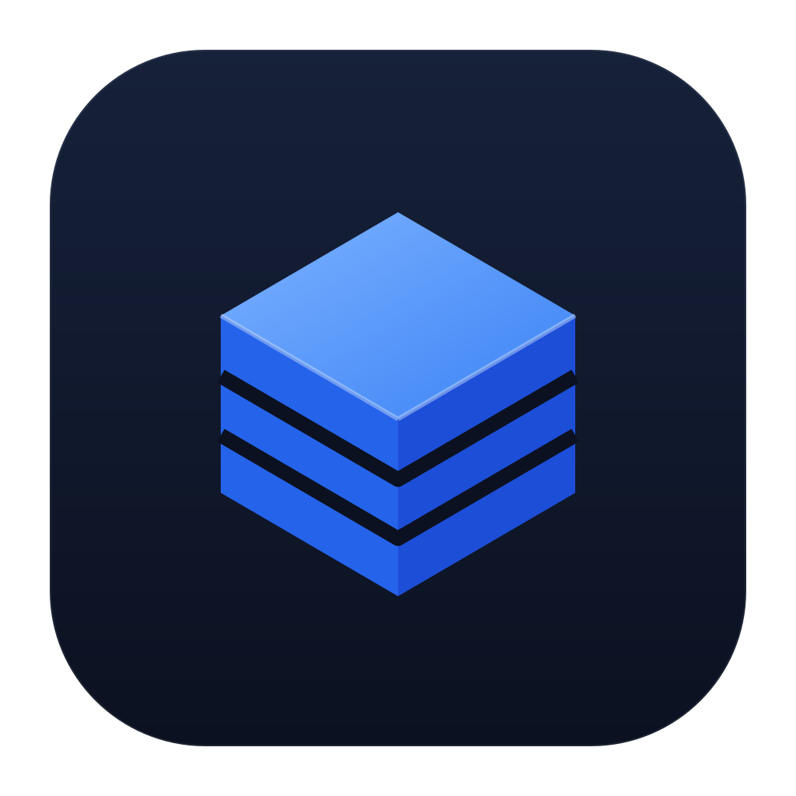

<div align="center">



# Quarry

**A small, fast desktop client for every database.**

PostgreSQL · MySQL · MariaDB · SQLite · SQL Server · ClickHouse · CockroachDB · TiDB · MongoDB · Redis · Valkey

One ~40 MB native app instead of pgAdmin + Compass + RedisInsight + a JVM.

[](https://github.com/HamzaBaghdadi/quarry/actions/workflows/build.yml)
[](LICENSE)

</div>

---

## Why

pgAdmin is a web server in a box. Compass is an Electron app for one database. DBeaver needs a JVM. Quarry is a single Go binary with a native webview (via [Wails](https://wails.io)) that talks to relational, document and key-value stores through one consistent UI:

- **Explorer** — lazy-loaded tree of databases → schemas → tables / collections / keys, with instant filtering.
- **Query editor** — CodeMirror with per-dialect SQL highlighting and autocomplete, mongosh-style queries for MongoDB, redis-cli commands for Redis. `Ctrl/⌘ + Enter` runs the selection or the whole buffer; long queries can be cancelled.
- **Data grid** — virtualized (scrolls 100k cells smoothly), resizable columns, server-side sort, `WHERE` / Mongo filter bar, pagination, keyboard navigation, cell inspector with pretty JSON, copy cell/row.
- **Find anything** — `Ctrl/⌘ + F` highlights matches in the loaded rows and steps through them; one more click (or `Ctrl/⌘ + Enter`) searches **every row of the table** in the database, across all columns.
- **Edit any cell** — double-click, press Enter/F2 or just start typing. Add rows, mark rows for deletion with `Del`, set NULL, edit long text or JSON in the side panel. Changes are staged (amber = edited, red = deleted, green = new) and written together with `Ctrl/⌘ + S` inside one transaction; if any row changed underneath you, nothing is saved. Works for SQL tables with a primary key, MongoDB documents (types such as ObjectId and dates are preserved) and Redis strings, hashes, lists, sets and sorted sets.
- **Backup & restore** — built in, no `pg_dump` or `mongodump` needed. PostgreSQL, MySQL/MariaDB/TiDB and SQLite back up to a portable `.sql` script (schema, rows, keys, indexes, views, sequences, enums) read from a consistent snapshot; MongoDB to an Extended-JSON archive with indexes; Redis/Valkey via `DUMP`/`RESTORE` with TTLs. Live progress, cancellable, and partial files are never left behind.
- **Export** — CSV or JSON via native save dialog.
- **Safe by default** — passwords live in the OS keychain (Windows Credential Manager, macOS Keychain, Secret Service). Mark a connection *read-only* to block writes on production.
- **Command palette** — `Ctrl/⌘ + K` to jump to any connection, table or action.
- **Auto-update** — Quarry checks GitHub Releases in the background, shows release notes, verifies the download's SHA-256 and restarts into the new version.
- **Native-feeling chrome** — custom title bar with breadcrumbs and search on Windows & Linux; macOS keeps its traffic lights. Right-click menus in the grid.
- **Easy on the eyes** — near-black theme (plus a light one) built with [shadcn/ui](https://ui.shadcn.com), fully keyboard-operable, visible focus everywhere.

## Supported engines

| Engine | Driver | Edit | Backup | Also works with |
| --- | --- | :-: | :-: | --- |
| PostgreSQL | pgx | ✓ | ✓ | Supabase, Neon, Timescale, YugabyteDB, AlloyDB |
| CockroachDB | pgx | ✓ | — ¹ | |
| MySQL / MariaDB / TiDB | go-sql-driver/mysql | ✓ | ✓ | PlanetScale, Vitess, Aurora MySQL |
| SQLite | modernc.org/sqlite (pure Go, no CGO) | ✓ | ✓ | libSQL files |
| SQL Server | go-mssqldb | ✓ | — ¹ | Azure SQL |
| ClickHouse | clickhouse-go | — | — ¹ | |
| MongoDB | mongo-go-driver v2 | ✓ | ✓ | DocumentDB, Cosmos DB (Mongo API), FerretDB |
| Redis / Valkey | go-redis | ✓ | ✓ | KeyDB, Dragonfly |

¹ Use the engine's native server-side backup (`BACKUP DATABASE`, `BACKUP TABLE … TO`, CockroachDB `BACKUP`).

Every engine accepts either individual fields or a full connection URL.

## Install

Download the latest build from **[Releases](https://github.com/HamzaBaghdadi/quarry/releases/latest)**:

| Platform | File |
| --- | --- |
| Windows | `quarry-windows-amd64-installer.exe` (or the portable `quarry-windows-amd64.exe`) |
| macOS (Apple Silicon & Intel) | `Quarry-macos-universal.zip` — not notarized yet, so run `xattr -cr Quarry.app` once after unzipping |
| Linux (x86-64) | `quarry-linux-amd64.tar.gz` — needs GTK 3 and WebKitGTK 4.0 |

After that, Quarry keeps itself up to date.

### Build from source

```bash
go install github.com/wailsapp/wails/v2/cmd/wails@v2.17.1
git clone https://github.com/HamzaBaghdadi/quarry && cd quarry
wails build
```

The binary lands in `build/bin/`. Requirements: Go 1.24+, Node 20+, pnpm, and on Linux `libgtk-3-dev libwebkit2gtk-4.0-dev`.

## Develop

```bash
wails dev
```

This runs the Next.js dev server with hot reload inside the desktop window. To work on the UI alone, run `pnpm dev` in `frontend/` and open http://localhost:3000 — without the Go backend the app switches to a built-in **demo mode** with simulated data, so every screen is explorable in a browser.

```bash
go test ./internal/...
```

## Architecture

```
main.go                  Wails bootstrap; blank-imports every driver
app.go                   Facade bound to the UI (thin; one method per action)
internal/
  driver/                Engine-agnostic contract: Driver, Conn, Node, Result + registry
  drivers/
    sqlbase/             Shared database/sql implementation (Template Method)
    postgres/ mysql/ sqlite/ mssql/ clickhouse/   ← small Dialects over sqlbase
    mongo/               Document adapter + mongosh-subset parser
    redis/               Key-value adapter
  session/               Live connection pool + cancellable queries
  store/                 Saved profiles (JSON) + OS keychain secrets (Repository)
  guard/                 Read-only statement guard
frontend/                Next.js (static export) + Tailwind v4 + Zustand
  lib/api.ts             Typed bridge to Go (falls back to lib/mock.ts in a browser)
  lib/store.ts           App state: connections, explorer cache, tabs
  components/            Workbench, Explorer, DataGrid, QueryTab, TableTab, …
```

**Patterns used**

- **Strategy + Registry** — each engine implements `driver.Driver` and registers itself in `init()`. The UI never hard-codes engines: drivers advertise their form fields, default port, query language and an example query, and the connection dialog renders from that.
- **Template Method** — `sqlbase.Engine` implements browsing, paging, executing, scanning and type normalisation once; SQL adapters only provide a `Dialect` (quoting, tree queries, pagination, database switching).
- **Facade** — `App` is the only surface exposed to JavaScript.
- **Repository** — `store.Store` hides where profiles and secrets live.
- **Uniform result model** — every engine returns the same `Result` (columns, rows, documents, timing), so one grid renders everything.

### Adding a database

1. Create `internal/drivers/<name>/`. For anything with a `database/sql` driver, return a `*sqlbase.Engine` with a `Dialect` — usually ~100 lines. Otherwise implement `driver.Conn` directly (see `redis/`).
2. Call `driver.Register(...)` in `init()`.
3. Blank-import it in `main.go`. Optionally add a monogram colour in `frontend/lib/engines.ts`.

## Design

Dark-first developer-tool aesthetic (OLED dark + Swiss minimalism): slate surfaces, blue for focus and primary actions, green reserved for *Run*, red for destructive actions. IBM Plex Sans for UI, JetBrains Mono for data and code, Phosphor icons. Dense 26 px rows, `tabular-nums` for numbers, colour-coded value types (NULL, numbers, booleans, JSON), WCAG-AA text contrast, `prefers-reduced-motion` respected.

## Keyboard

| Action | Shortcut |
| --- | --- |
| Run query / selection | `Ctrl/⌘ Enter` |
| Find in results | `Ctrl/⌘ F` (`Enter` / `Shift Enter` to step, `Ctrl/⌘ Enter` for all rows) |
| Command palette | `Ctrl/⌘ K` |
| New query tab | `Ctrl/⌘ T` |
| Close tab | `Ctrl/⌘ W` |
| Next / previous tab | `Ctrl Tab` / `Ctrl Shift Tab` |
| New connection | `Ctrl/⌘ N` |
| Move in grid | Arrow keys, `PgUp`/`PgDn`, `Home`/`End` |
| Copy cell / row | `Ctrl/⌘ C` / `Ctrl/⌘ Shift C` |
| Edit cell | Double-click, `Enter`, `F2` or start typing |
| Inspect / edit long value | `Space` |
| Mark row for deletion | `Del` |
| Save changes | `Ctrl/⌘ S` |

## Roadmap

- Table structure view (columns, indexes, foreign keys) and ER diagram
- SSH tunnels
- Query history and saved snippets
- More engines: Oracle, Cassandra/ScyllaDB, DynamoDB, Elasticsearch/OpenSearch, DuckDB, Snowflake, BigQuery

## License

[Apache License 2.0](LICENSE). See [NOTICE](NOTICE) for third-party attributions.
